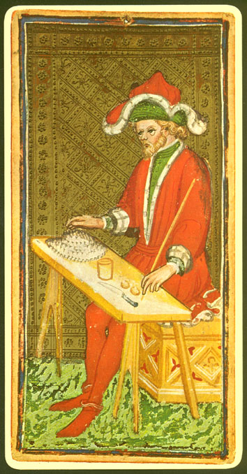
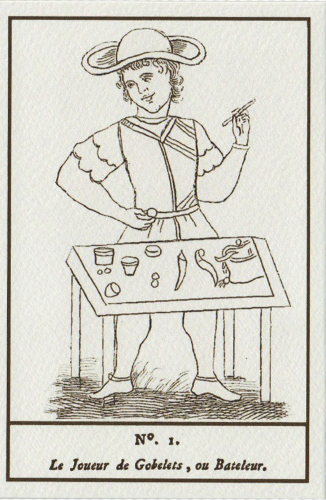
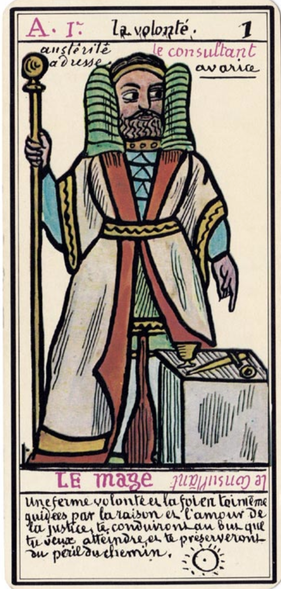
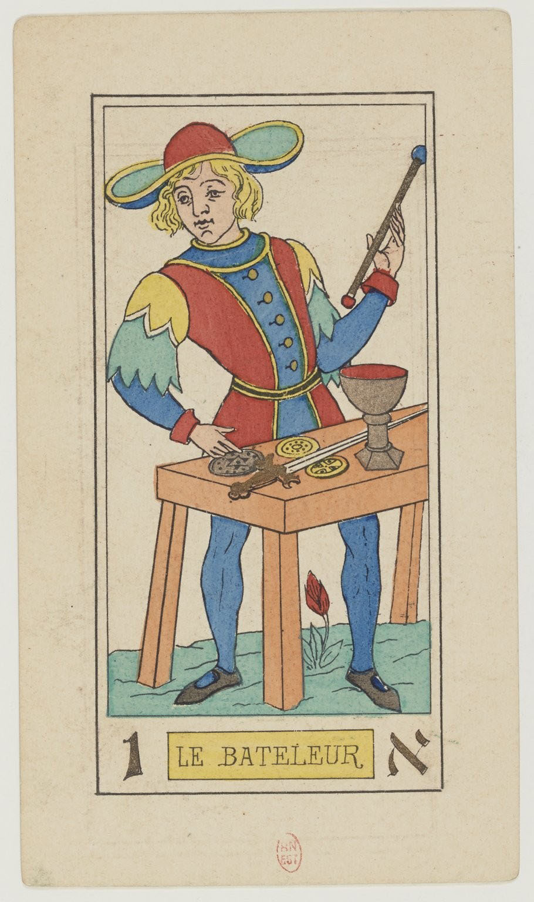
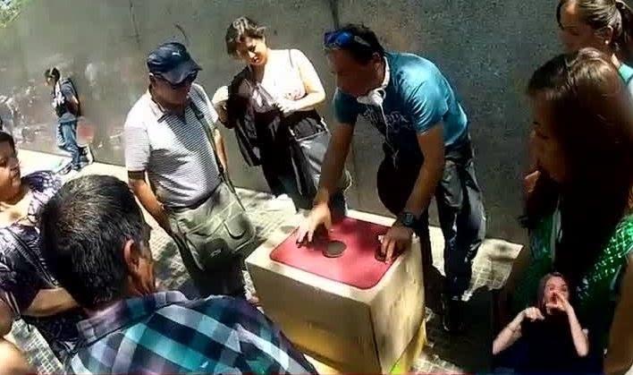
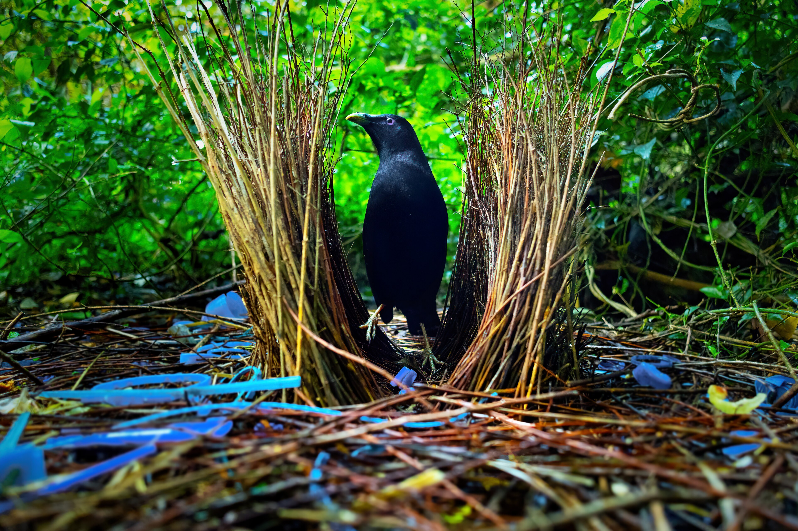
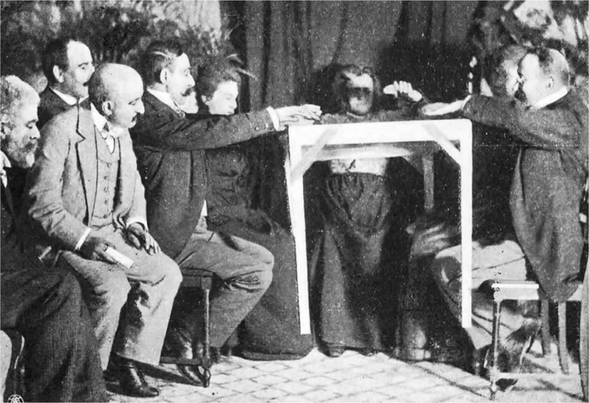

# Constelación

modo: libre
forma: original
etiqueta: fecha

## Conexiones

- le-bateleur -> mago
- mago <-> faraday : actitud
- bateleur -> le-bateleur : reinterpretación ocultista
- bagatto -> bateleur : de italia a francia
- prestidigitador -> bateleur
- prestidigitador -> faraday : espectáculo
- prestidigitador <-> pepito : embaucadores
- charlatan -> bateleur
- prestidigitador -- charlatan
- heron -> faraday : ciencia y asombro
- mago -> satin-bowerbird
- eusapia -> faraday : comunidad científica
- pepito -> bateleur : prestidigitador

## mago

Grado 0 de este proyecto. Carta del tarot del mazo Raider Waite, ilustrado por Pamela Colman Smith. 

Visualmente, presenta a una persona de mirada serena, con una mesa adelante con materiales a su disposición. Mira hacia el frente, con mirada serena. Apunta hacia la tierra y hacia al cielo, lo que en la lógica platónica dualista parece querer conectar lo inmanente con lo trascendental. En ese sentido, es una figura límite, que se mueve y recorre los bordes. En su cabeza está la lemniscata, sugiriendo que su imaginación es la que le permite ampliar el campo de lo posible. Lo posible, bajo mi lectura, se encuentra siempre encerrado por la flora, donde surge mi hipótesis: la Naturaleza como espacio de lo posible, y la figura del mago como agente que rompe la barrera entre lo que sabemos y lo que aún no tenemos certezas. Es un trabajo no solo de sabiduría, sino de exploración material, ya que no parece tener claridad inmediata sobre lo que está haciendo, pero lo está mostrando. Esto, que en términos virtuosos se puede ver como un ejercicio pedagógico, se puede utilizar también como acto de confusión, manipulación y engaño.

Mediado desde el dibujo de Conver por "Les 22 Arcanes du Tarot Kabbalistique" (1889) Fue publicado luego de que Aleister revelara secretos de la hermética orden "Golden Dawn" al público general, lo que entusiasmó a Waite. Fue la primera baraja de éxito comercial en Gran Bretaña. A la ilustradora, Pamela Colman Smith se le pagó un pequeño monto por las ilustraciones y nunca recibió royalties (Decker, 176). Waite reemplazó, por error, los oros en "pentacles", que en realidad quería aludir a "pantacle", o talismán. (Decker, 46)

## bagatto

il bagatto (S. XVI)

En Italia el tarocci fue concebido como un juego de cartas, y el bagato era la carta de menor rango, el primero de los Trump (triunfos), lo que después serían llamados arcanos mayores. No corresponde a un mago, sino que a un comerciante. Se le considera una carta de bajo valor (bagatela), y si bien se puede considerar un prestigitador, no alcanza el estatus de mago o magus que conseguiría en el ocultismo posterior. (Decker, 44). Aparece la mesa de tres patas, objetos en la mesa, las manos manipulando materiales, pero se le ve sentado, ensimismado, en contraste a otras imágenes.

## le-bateleur

Le Bateleur, Court de Gébelin, Monde primitif, vol. VIII (1781)

En el mazo de Court de Gébelin, el bateleur, o el jugador de cubiletes (prestidigitador), sostiene una vara con la que sería utilizado para engañar a los crédulos. (Decker, 70) En este punto, se basan en la mitología egipcia para acercar al personaje al ocultismo. La palabra tarocci italiana fue traducida como tarot al francés. Hubo autores (como de Mellet) que intentaron darle una etimología basada en el egipcio, con palabras inventadas (Decker, 68). 

En esta versión, el mago mira fuera de la mesa de 4 patas, aunque se eleva más una de sus manos. Su sombrero parece acercarse a una lemniscata

## bateleur

![Nicolas Conver, Le Bateleur (El Mago / Prestidigitador, Arcano Mayor I del Tarot de Marsella), 1760. Xilografía iluminada con plantilla a mano, Bibliothèque nationale de France (BnF), Département des Estampes et de la photographie, París. El arquetipo fundacional del mago en la tradición cartomántica europea premoderna: un juglar y prestidigitador callejero ataviado con sombrero en forma de lemniscata infinita sostiene una varita mágica ante su mesa de tres patas, donde despliega los implementos clásicos del ilusionismo popular y los cuatro palos esotéricos (dados, monedas, copas y cuchillo). https://gallica.bnf.fr/ark:/12148/btv1b10537494x](./buscador-magos/magos-img/15-mago-tarot-marsella-le-bateleur-conver.jpg)

Nicolas Conver, Le Bateleur, 1760. 

Carta utilizada como juego. En esta bajara se comenzó a incluir el nombre de los "triunfos". Si bien el origen era italiano, el tarot de Marsella fue el más conocido fuera de ese país. La baraja fue sinónimo de tarot mucho tiempo, y cualquier mención a las características de esta baraja así, es herencia de la tradición ocultista francesa, que le dio el salto del juego a lo místico (Decker, 36-37)

La carta aparece con tres patas, con otra variedad de objetos sobre la mesa que el de Raider Waite. El sombrero se comienza a asemejar a la lemniscata

## belline

Edmond, Le Mage, ca. 1863–1870. Publicado por Grimaud como Grand Tarot Belline.

Mazo dibujado a mano, en tinta, por el cartomante parisino Edmond Billaudot para su propio uso. Lo encontró Marcel Belline, otro cartomante que trabajaba en la misma calle donde había vivido Edmond, y se lo pasó a Grimaud para que lo comercializara. Belline donó los originales al Musée des Arts et Traditions populaires (Decker, 162). Una carta extra afirma que Napoleón III mandó llamar a Edmond a las Tullerías para conocer su futuro, y que Edmond le leyó las cartas con este mazo. Los nombres y la numeración siguen a Paul Christian, así que el mazo es posterior a 1863 y, si la historia de Napoleón es cierta, anterior a 1870 (Decker, 202-203). Aquí el bateleur ya no es un timador de plaza: es "le Mage", y la carta se titula "la volonté".

El mago es una figura imponente, barbada y con túnica, con un tocado a la egipcia. Sostiene un bastón y apunta hacia abajo con la otra mano. La mesa se transformó en una piedra cúbica, y sobre ella hay una espada, una moneda y una copa (Decker, 203). La carta además le habla a quien consulta: "une ferme volonté et la foi en toi-même… te conduiront au but que tu veux atteindre". El mago ya no engaña a la masa, sino que aconseja.

## wirth

Oswald Wirth, Le Bateleur, Les 22 Arcanes du Tarot Kabbalistique (1889).

Wirth era un suizo que comenzó como sanador por hipnosis y era masón desde 1884. Stanislas de Guaita lo introdujo en el ocultismo y le encargó cumplir el proyecto que Eliphas Lévi había dejado pendiente: "restituir los veintidós Arcanos del Tarot a su pureza jeroglífica". Wirth no sabía nada de tarot y siguió las instrucciones de De Guaita. El mazo tenía solo los 22 arcanos mayores y se publicó en una edición de 350 ejemplares "para uso de los iniciados". Fue el primer tarot ocultista publicado que no derivaba de Etteilla (Decker, 238). Cada carta lleva su número, su nombre y una letra hebrea, según la atribución de Lévi. En su ensayo para Papus, Wirth sostiene que los arcanos mayores son "reproducciones desfiguradas de un modelo primitivo"; Decker ironiza que, a juzgar por la restitución de Wirth, la desfiguración fue sorprendentemente leve para tanto tiempo (Decker, 239).

El dibujo sigue de cerca al de Marsella, pero con cambios para acomodar las ideas ocultistas: por primera vez aparecen sobre la mesa los cuatro palos (Decker, 239), copa, espada, monedas y la varita en la mano. La mesa vuelve a tener cuatro patas y aparece la letra alef. A sus pies crece una flor, quizás un anticipo del follaje que rodea al mago de Rider-Waite. La carta de Wirth es la que media entre Conver y Rider-Waite.

## faraday

Alexander Blaikley, Professor Faraday lecturing at the Royal Institution before HRH Prince Albert, the Prince of Wales, and Prince Alfred, 1856 <https://commons.wikimedia.org/wiki/File:Faraday_lecture_at_Royal_Institution_1856.jpg>

La actitud es similar a la del mago, en la postura, la mesa, los materiales, rodeado esta vez por una multitud en vez de la naturaleza. La ciencia del siglo XIX, en tanto descubría, también requería Para Faraday, la oratoria era un espacio tan importante como el laboratorio, y era un arte que para amaestrarse requería el mismo nivel de dedicación, y sus experimentos tenían relación con conocer las leyes de la naturalza (Finnegan, 196). La aproximación de Faraday es conocida por ser experimental, y lo que dio el marco a las posteriores teorías de Maxwell, donde la producción de imágenes desde las líneas de movimiento de los materiales magnéticos fue fundamental para la teoría del campo magnético (Gooding, 111)

## prestidigitador

![Hieronymus Bosch (El Bosco) o seguidor, El prestidigitador (L'Escamoteur / The Conjurer), ca. 1496–1502. Óleo sobre tabla, Musée municipal de Saint-Germain-en-Laye, Francia. Obra emblemática del Renacimiento flamenco que retrata el ilusionismo profano y callejero: un prestidigitador realiza el truco de manos con cubiletes y bolitas ante la muchedumbre asombrada, mientras un cómplice aprovecha la distracción del público para sustraer la bolsa de monedas a un espectador embelesado. https://commons.wikimedia.org/wiki/File:Hieronymus_Bosch_(follower)_-_The_Conjurer_(Mus%C3%A9e_Saint-Germain-en-Laye).jpg](./buscador-magos/magos-img/03-mago-renacimiento-el-prestidigitador-bosch.jpg)

Hieronymus Bosch (El Bosco) o seguidor, El prestidigitador (L'Escamoteur / The Conjurer), ca. 1496–1502. Óleo sobre tabla, Musée municipal de Saint-Germain-en-Laye, Francia.
 
En esta imagen aparece el ilusionismo profano y callejero, un prestidigitador realiza el truco de manos con cubiletes y bolitas ante la muchedumbre asombrada, mientras un cómplice aprovecha la distracción del público para sustraer la bolsa de monedas a un espectador embelesado. Se repite la mesa, los objetos, y la lógica de espectáculo

## pepito

pepito paga doble

## charlatan

Pietro Longhi, El charlatán (Il Ciarlatano), 1757. Óleo sobre lienzo (62 × 50 cm), Ca' Rezzonico, Museo del Settecento Veneziano, Venecia. Documento pictórico del siglo XVIII veneciano que muestra la figura popular del embaucador y mago de plaza pública: subido a un estrado con máscara y capa, realiza pases de manos y ofrece remedios prodigiosos ante caballeros y damas con la tradicional _bauta_ veneciana. https://carezzonico.visitmuve.it/

## heron

Herón de Alejandría según Louis Figuier (1819–1894)

Herón de Alejandría fue un proto científico griego del siglo primero, interesado en las propiedades del aire. Tenían un interés particular en los aspectos materiales de la investigación de las fuerzas de la Naturaleza, como de su utilidad y de su estética: "Pues, por la unión del aire, la tierra, el fuego y el agua, y por el concurso de tres o cuatro principios elementales, se producen diversas combinaciones, algunas de las cuales satisfacen las necesidades más apremiantes de la vida humana, mientras que otras provocan asombro y alarma." (Woodcroft, 1; traducción propia)

## satin-bowerbird

ave que recolecta objetos azules

## eusapia

Enrico Morselli,  Psicologia e spiritismo: Impressioni e note critiche sui fenomeni medianici di Eusapia Paladino, 1908

<!-- posiciones: {"mago":[375,-567],"bagatto":[-383,-451],"le-bateleur":[22,-340],"bateleur":[-33,-85],"belline":[141,-114],"wirth":[159,88],"faraday":[350,-294],"prestidigitador":[-344,-828],"pepito":[1009,-1004],"charlatan":[-108,-815],"heron":[-675,-105],"satin-bowerbird":[970,-563],"eusapia":[373,-7]} -->
