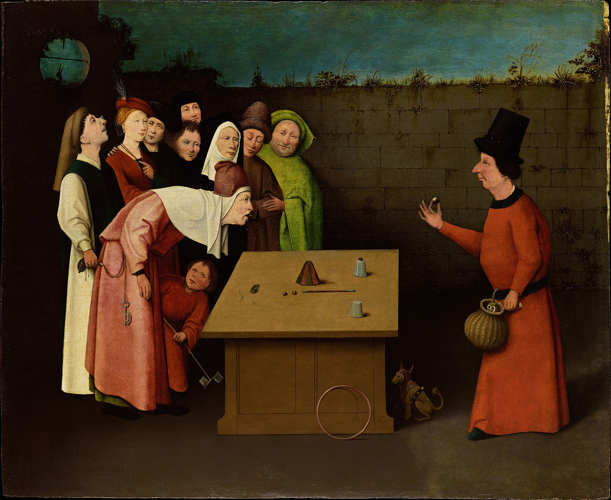
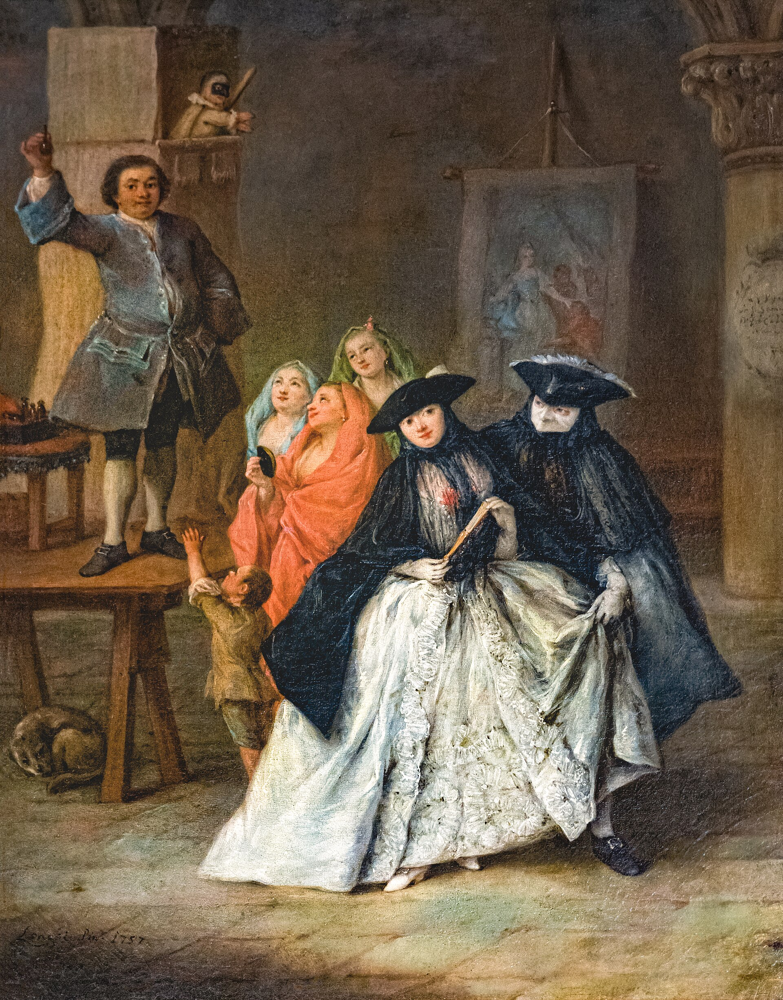
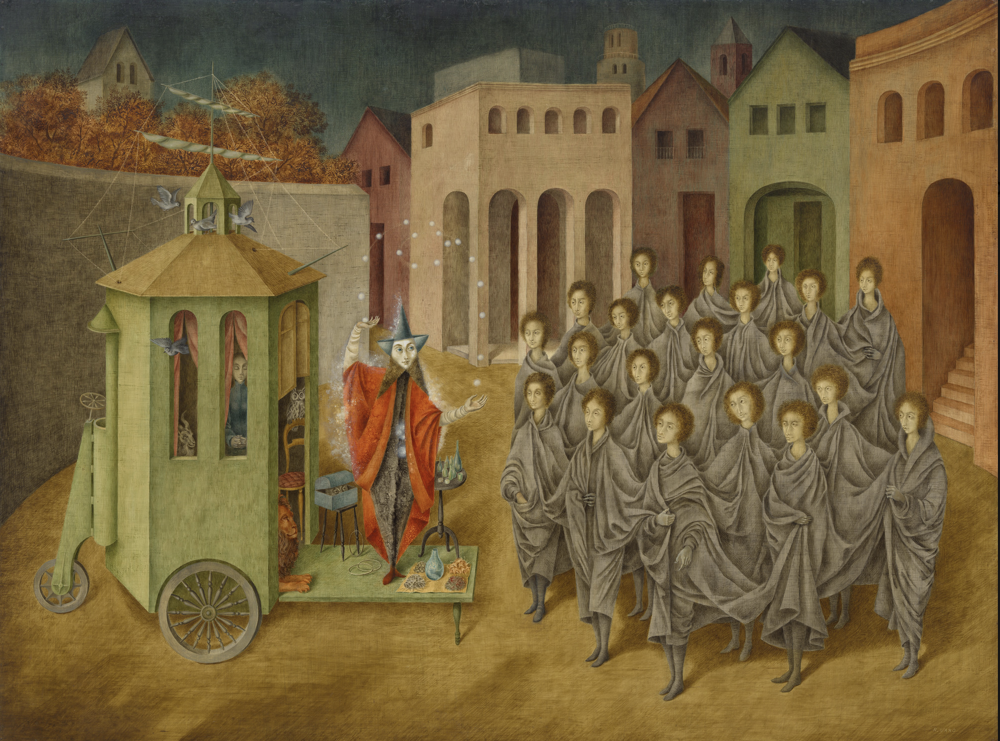
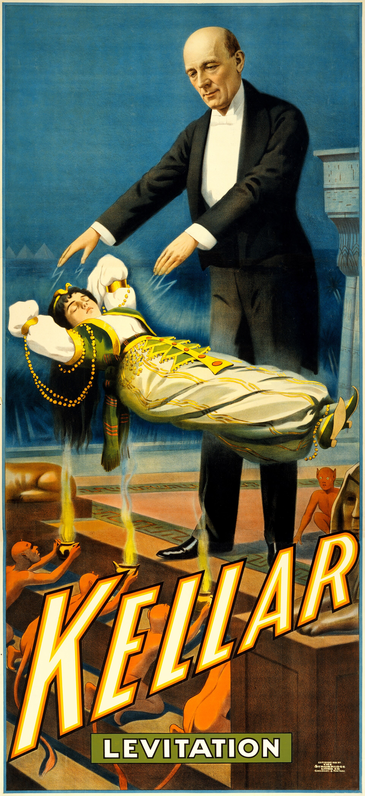
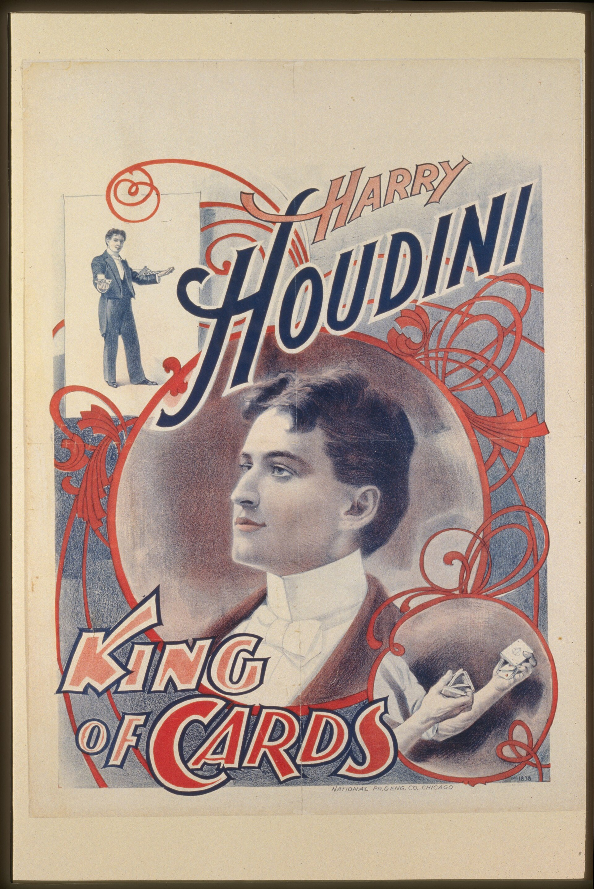

# Constelación

## Conexiones

- El prestidigitador -> El charlatán : de la calle al estrado
- El charlatán -> El juglar : la masa mira
- El juglar <-> El mago : arcano I
- El prestidigitador -> El mago : la mesa y los cubiletes
- Kellar -> Houdini : del vodevil
- Faraday -- Kellar : la demostración como espectáculo
- El juglar -- Kellar

## El prestidigitador

Hieronymus Bosch (El Bosco) o seguidor, *El prestidigitador*, ca. 1496–1502. Un prestidigitador hace el truco de los cubiletes ante la muchedumbre asombrada, mientras un cómplice aprovecha la distracción para robarle la bolsa a un espectador.

## El charlatán

Pietro Longhi, *El charlatán*, 1757. El embaucador de plaza pública, subido a un estrado con máscara y capa, ofrece remedios prodigiosos ante damas y caballeros con la *bauta* veneciana.

## El juglar

Remedios Varo, *El juglar (El mago)*, 1956. Un mago despliega sus prodigios desde un carromato ante una multitud de personajes idénticos, envueltos en una misma tela gris que los une como un solo cuerpo.

## El mago

El Mago, arcano I del tarot Rider-Waite.

## Kellar

*Kellar: The Levitation of Princess Karnac*, 1900. Cartel de la célebre ilusión de levitación escénica de Harry Kellar, rodeado de demonios susurrantes.

## Houdini

*Harry Houdini, King of Cards*, ca. 1900. Houdini antes de sus fugas, como prestidigitador de naipes en el vodevil americano.

## Faraday

Michael Faraday realiza una demostración ante un público numeroso en una sala de conferencias victoriana.
