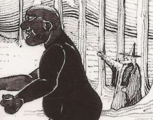
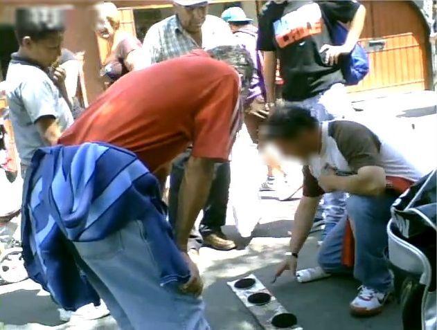

# Imágenes

<!--  -->

![Joseph Benoît Suvée, The Invention of the Art of Drawing, ca. 1791. "George Didi-Huberman has demonstrated how these secular images of representation have a predecessor in Christian icons known as acheiropoieton (made without hands), like the Manoppelo Image and the Holy Shroud of Turin, miraculously emblazoned with the face of Jesus Christ, as if his shadow could leave a stain. “What has touched the god often becomes untouchable par excellence”, he writes, “it withdraws into the shadow of the mystery (and is constituted forever as an object of desire).” https://publicdomainreview.org/collection/origins-of-painting/](./imagenes/benoit.webp)

![Katsushika Hokusai's illustration of Tomowaka, son of Minamoto no Tametomo, escaping exile aboard a giant kite, from Kyokutei Bakin's Chinsetsu Yumiharizuki (Strange Tales of the Crescent Moon), second part, vol. 3, ca. 1808–1809. In Takizawa Bakin’s sixty-eight-chapter serial novel, Chinsetsu Yumiharizuki (Strange Tales of the Crescent Moon, 1807–1811) — richly illustrated by Hokusai — the exiled samurai Minamoto no Tametomo sends his son Tomowaka back to the mainland on a giant kite, in order to become the adopted heir to a samurai leader. Other Japanese annals tell of archers mounted to kites who fire down upon their enemies, and of the bandit Ishikawa Goemon riding a kite to infiltrate Nayoga Castle. https://publicdomainreview.org/collection/art-of-kite-flying/](./imagenes/kite-flying-00068.webp)

![Peter's conflict with Simon Magus by Avanzino Nucci, 1620. Simon is on the right, wearing black. En el texto cristiano apócrifo de los Hechos de Pedro se narra una de las fantasiosas leyendas más conocidas acerca de Simón el Mago. Allí se dice que Simón exhibía sus poderes mágicos en Roma, volando ante el emperador romano Nerón en el Foro Romano; para probar su condición divina, los apóstoles Pedro y Pablo rogaron a Dios que detuviese su vuelo: Simón paró en seco y cayó a tierra, donde fue apedreado.](./imagenes/simon-mago.jpg)

![Hieronymus Bosch (El Bosco) o seguidor, El prestidigitador (L'Escamoteur / The Conjurer), ca. 1496–1502. Óleo sobre tabla, Musée municipal de Saint-Germain-en-Laye, Francia. Obra emblemática del Renacimiento flamenco que retrata el ilusionismo profano y callejero: un prestidigitador realiza el truco de manos con cubiletes y bolitas ante la muchedumbre asombrada, mientras un cómplice aprovecha la distracción del público para sustraer la bolsa de monedas a un espectador embelesado. https://commons.wikimedia.org/wiki/File:Hieronymus_Bosch_(follower)_-_The_Conjurer_(Mus%C3%A9e_Saint-Germain-en-Laye).jpg](./buscador-magos/magos-img/03-mago-renacimiento-el-prestidigitador-bosch.jpg)

![Merlín dictando sus profecías a su escriba Blaise, ca. 1300. Miniatura medieval en témpera y pan de oro sobre pergamino, perteneciente al manuscrito en prosa del Roman de Merlin / Lancelot-Graal (Français 95, folio 113v), Bibliothèque nationale de France (BnF), París. El sabio y hechicero legendario Merlín, figura cumbre de la tradición artúrica y de la magia en la Edad Media, aparece como profeta y consejero dictando las crónicas secretas y revelaciones arcanas a su maestro, el ermitaño Blaise. https://gallica.bnf.fr/ark:/12148/btv1b10022284t](./magos-img/02-mago-medieval-merlin-blaise.jpg)

![Rembrandt van Rijn, Un erudito en su estudio contemplando un disco mágico (conocido tradicionalmente como Fausto), ca. 1652. Aguafuerte, punta seca y buril, The Metropolitan Museum of Art, Nueva York (Accession Number: 23.31.21) / Rijksmuseum, Ámsterdam. Una de las cumbres del grabado barroco: un sabio, alquimista y ocultista se pone de pie junto a su mesa de trabajo al irrumpir en su aposento una misteriosa aparición luminosa en forma de disco con un anagrama cabalístico radiante en la ventana, sintetizando el mito fáustico y la búsqueda de la sabiduría esotérica universal. https://www.metmuseum.org/art/collection/search/387498](./magos-img/05-mago-barroco-fausto-rembrandt.jpg)

![John William Waterhouse, El círculo mágico (The Magic Circle), 1886. Óleo sobre lienzo (183 × 127 cm), Tate Britain, Londres (Número de catálogo: N01572). Obra maestra del simbolismo y prerrafaelismo tardío del siglo XIX: una hechicera traza en la arena un círculo protector con su varita ardiente mientras sostiene una hoz lunar y cocina un brebaje en un caldero humeante bajo el vuelo de cuervos, evocando la fascinación romántica por la brujería ceremonial y los mitos clásicos. https://www.tate.org.uk/art/artworks/waterhouse-the-magic-circle-n01572](./magos-img/07-mago-siglo-xix-circulo-magico-waterhouse.jpg)

![Harry Kellar, Kellar: The Levitation of Princess Karnac, 1900. Cartel litográfico en color impreso por The Strobridge Lithographing Co., Cincinnati & New York. Library of Congress, Prints and Photographs Division, Washington, D.C. (LCCN 2014636900). Gran cartel publicitario de comienzos del siglo XX que promocionaba la célebre ilusión de levitación escénica desarrollada por Harry Kellar, decano de los magos estadounidenses en la Belle Époque, rodeado de demonios susurrantes en un ambiente de ilusionismo teatral a gran escala. https://www.loc.gov/item/2014636900/](./magos-img/09-mago-siglo-xx-levitacion-kellar.jpg)

![Dosso Dossi (Giovanni di Niccolò de Lutero), Melissa (o Circe), ca. 1518–1531. Óleo sobre lienzo (176 × 174 cm), Galleria Borghese, Roma (Inv. 217). Pintura cumbre del Renacimiento ferrarense inspirada en el Orlando Furioso de Ludovico Ariosto: representa a la maga benevolente Melissa sentada dentro de un círculo mágico de protección decorado con símbolos astrológicos y cabalísticos. Con una antorcha encendida en la mano y una tablilla de conjuros a sus pies, disuelve los encantamientos de la hechicera Alcina para restituir a los caballeros petrificados o convertidos en árboles a su forma humana original. https://collezionegalleriaborghese.it/opere/melissa](./magos-img/12-mago-renacimiento-maga-melissa-dosso-dossi.jpg)

![Agostino Veneziano (Agostino dei Musi, según Rafael o Giulio Romano), Lo Stregozzo (La procesión de la bruja y los magos nigromantes), ca. 1515–1525. Grabado al buril sobre papel verjurado, The Metropolitan Museum of Art, Nueva York (Accession Number: 49.97.108) / British Museum, Londres. Obra fundamental de la gráfica renacentista italiana sobre magia oscura y nigromancia: una hechicera monta sobre el esqueleto monstruoso de un animal fantástico mientras hechiceros y asistentes desnudos conducen la procesión ceremonial entre cañaverales con antorchas, cuernos y huesos rituales en medio de la noche. https://www.metmuseum.org/art/collection/search/338274](./magos-img/13-mago-renacimiento-lo-stregozzo-agostino-veneziano.jpg)

![Ebenezer Sibly (diseño) y grabador anónimo, John Dee y Edward Kelley en el círculo mágico de nigromancia, 1784. Grabado calcográfico publicado en A New and Complete Illustration of the Celestial Science of Astrology, Londres (Bodleian Library / Wellcome Collection). Ilustra una de las leyendas más célebres de la magia ritual isabelina del siglo XVI: el matemático, cosmógrafo y astrólogo real de Isabel I, el Dr. John Dee, junto a su médium y alquimista Edward Kelley, pertrechados con grimorios, vara mágica y antorcha en el interior de un círculo consagrado con nombres divinos para conjurar la aparición de un espíritu en el cementerio de Walton-le-Dale. https://wellcomecollection.org/works/m5fswcxj](./magos-img/14-mago-magia-ritual-john-dee-edward-kelley.jpg)

![Nicolas Conver, Le Bateleur (El Mago / Prestidigitador, Arcano Mayor I del Tarot de Marsella), 1760. Xilografía iluminada con plantilla a mano, Bibliothèque nationale de France (BnF), Département des Estampes et de la photographie, París. El arquetipo fundacional del mago en la tradición cartomántica europea premoderna: un juglar y prestidigitador callejero ataviado con sombrero en forma de lemniscata infinita sostiene una varita mágica ante su mesa de tres patas, donde despliega los implementos clásicos del ilusionismo popular y los cuatro palos esotéricos (dados, monedas, copas y cuchillo). https://gallica.bnf.fr/ark:/12148/btv1b10537494x](./magos-img/15-mago-tarot-marsella-le-bateleur-conver.jpg)

![Joseph Wright of Derby, El alquimista en busca de la piedra filosofal descubre el fósforo (The Alchymist, In Search of the Philosopher's Stone), 1771. Óleo sobre lienzo (127 × 101,6 cm), Derby Museum and Art Gallery, Derby, Reino Unido. Obra maestra del claroscuro en plena Ilustración que capta la encrucijada histórica entre el misticismo arcano del mago-alquimista y los albores de la química moderna: en su laboratorio gótico abovedado, el anciano adepto cae de rodillas asombrado al ver cómo su retorta destila una sustancia incandescente que emite una luz sobrenatural y pura. https://www.derbymuseums.org/collection/item/the-alchymist-in-search-of-the-philosophers-stone-1771](./magos-img/16-mago-ilustracion-el-alquimista-wright-of-derby.jpg)

![Evelyn De Morgan (nacida Evelyn Pickering), Medea, 1889. Óleo sobre lienzo (148 × 89 cm), Williamson Art Gallery and Museum, Birkenhead, Reino Unido. Destacada obra del simbolismo y prerrafaelismo victoriano tardío que aborda el mito clásico de la hechicera Medea: la princesa de Cólquida y sacerdotisa de Hécate aparece en los aposentos palaciegos vestida con túnica rosa y manto carmesí, sosteniendo en su mano un frasco de vidrio con una poción venenosa brillante mientras reflexiona sobre su trágico destino de magia, amor y venganza. https://victorianweb.org/painting/demorgan/paintings/11.html](./magos-img/18-mago-simbolismo-maga-medea-evelyn-de-morgan.jpg)

![The Strobridge Lithographing Co., Harry Houdini, King of Cards, ca. 1900. Cartel litográfico en color, Library of Congress, Prints and Photographs Division, Washington, D.C. (LCCN 2014636910). Histórico cartel publicitario que documenta la primera etapa profesional de Harry Houdini (Erik Weisz, 1874–1926) como prodigioso prestidigitador e ilusionista antes de sus legendarias fugas: retratado de frac con mirada penetrante mientras despliega abanicos de cartas y naipes flotantes en plena época del vodevil americano de comienzos del siglo XX. https://www.loc.gov/item/2014636910/](./magos-img/20-mago-siglo-xx-houdini-king-of-cards.jpg)

![Benozzo Gozzoli, La caída de Simón el Mago (The Fall of Simon Magus), 1461–1462. Temple y oro sobre tabla de álamo (24 × 35,5 cm), Royal Collection Trust, Reino Unido (RCIN 403372). Tabla de la predela del retablo de la Compañía de la Purificación de Florencia: narra el enfrentamiento legendario en Roma entre los apóstoles Pedro y Pablo y el mago samaritano Simón el Mago, quien intentó demostrar su poder sobrenatural elevándose por los aires con ayuda de demonios antes de precipitarse al vacío ante el emperador Nerón. https://www.rct.uk/collection/403372/the-fall-of-simon-magus](./magos-img/25-mago-medieval-caida-simon-mago-benozzo-gozzoli.jpg)

![William Blake, La x|noche de la alegría de Enitharmon (anteriormente conocida como Hécate o La triple hechicera), 1795. Estampa en color con tinta y acuarela sobre papel (43,9 × 58,1 cm), Tate Britain, Londres (Catálogo: N05056). Visión mística y mitológica del romanticismo visionario británico: la triple diosa de la magia, Hécate, aparece sentada junto a las criaturas de la noche (búho, murciélago y asno fantástico) con la mano apoyada en un libro de encantamientos prohibidos. https://www.tate.org.uk/art/artworks/blake-the-night-of-enitharmons-joy-formerly-called-hecate-n05056](./magos-img/32-mago-visionario-hecate-william-blake.jpg)

![Francisco de Goya y Lucientes, ¡Linda maestra! (Los Caprichos, estampa n.º 68), 1799. Aguafuerte, aguatinta bruñida y punta seca sobre papel (21,8 × 15,2 cm), Museo Nacional del Prado, Madrid (G02156). Estampa emblemática de la serie de Los Caprichos: una vieja hechicera adiestra a su joven discípula en el arte de volar sobre una escoba en la oscuridad de la noche, acompañada por el búho de la sabiduría oscura, en una sátira implacable contra la enseñanza de las falsas artes mágicas. https://www.museodelprado.es/coleccion/obra-de-arte/linda-maestra/3421d09e-a0e2-4912-9c90-0f2b31be5d91](./magos-img/34-mago-siglo-xviii-linda-maestra-goya.jpg)

![Grabador anónimo, Retrato de Heinrich Cornelius Agrippa von Nettesheim, siglo XVII (d.c. original de 1533). Grabado calcográfico sobre papel, Wellcome Collection, Londres (Iconographic Collection M0002736). Retrato de Heinrich Cornelius Agrippa (1486–1535), uno de los teóricos y filósofos de la magia más influyentes del Renacimiento europeo, autor de De occulta philosophia libri tres (1533), tratado fundacional que sintetizó la magia natural, la magia celeste y la magia ceremonial o teúrgica. https://wellcomecollection.org/works/tq4f2hvv](./magos-img/37-mago-filosofia-oculta-cornelius-agrippa.jpg)

![John William Waterhouse, Circe Invidiosa (Circe envenenando el mar), 1892. Óleo sobre lienzo (180,7 × 87,4 cm), Art Gallery of South Australia, Adelaida (Gift of Miss Sarah Elizabeth Roach). Representación de la metamorfosis mítica narrada por Ovidio: la maga Circe, movida por los celos hacia la ninfa Escila, camina sobre las aguas marinas mientras vierte un veneno de color verde intenso en la corriente que transformará a su rival en un monstruo marino aterrador. https://www.agsa.sa.gov.au/collection-publications/collection/works/circe-invidiosa/](./magos-img/42-mago-simbolismo-circe-invidiosa-waterhouse.jpg)

![Frederick Sandys (Anthony Frederick Augustus Sandys), Morgan le Fay, 1864. Óleo sobre tabla (61,8 × 44,4 cm), Birmingham Museum and Art Gallery, Birmingham, Reino Unido (Accession: 1925P104). Pintura prerrafaelita que retrata a la hechicera artúrica Morgana: iluminada por el fuego ritual de su trípode mágico y ataviada con una piel de leopardo, vierte encantamientos sobre una capa tejida para su hermano, el rey Arturo, mientras consulta tablillas y pergaminos de brujería. https://www.birminghammuseums.org.uk/explore-art/items/1925P104/morgan-le-fay](./magos-img/43-mago-prerrafaelismo-morgan-le-fay-sandys.jpg)

![Evelyn De Morgan, La poción de amor (The Love Potion), 1903. Óleo sobre lienzo (104,1 × 52,1 cm), The De Morgan Centre / Wightwick Manor (National Trust), Reino Unido. Pintura simbolista victoriana que muestra a una hechicera y sabia con túnica dorada mezclando un filtro amoroso en un matraz de vidrio, rodeada de libros de invocación y un gato negro familiar a sus pies, mientras a través de la ventana se divisan caballeros que acuden al castillo. https://www.demorgan.org.uk/collection/the-love-potion/](./magos-img/44-mago-prerrafaelismo-pocion-amor-de-morgan.jpg)

![Gustave Moreau, La aparición (L'Apparition), 1876. Óleo sobre lienzo (142 × 103 cm), Musée Gustave Moreau, París / Fogg Art Museum, Harvard University. Arquetipo del simbolismo decadente del siglo XIX: en un palacio oriental profusamente ornamentado con arquitectura mágica y columnas arcanas, Salomé danza semidesnuda ante la visión luminosa y espectral de la cabeza flotante de Juan el Bautista, irradiando halos sobrenaturales en una atmósfera de misticismo hierático. https://collections.louvre.fr/ark:/53355/cl010065261](./magos-img/45-mago-simbolismo-aparicion-gustave-moreau.jpg)

![The Strobridge Lithographing Co., Harry Kellar brinda con el diablo (Harry Kellar toasts the Devil), ca. 1899. Cartel litográfico en color (76 × 101 cm), Library of Congress, Prints and Photographs Division, Washington, D.C. (LCCN 2014636906). Icónico cartel de vodevil victoriano tardío: Harry Kellar, con copa en mano y sonrisa enigmática, intercambia un brindis con un diablo mefistofélico rojo sentado frente a él, sintetizando la fascinación del público de finales del siglo XIX por la ilusión y los espíritus traviesos del escenario. https://www.loc.gov/item/2014636906/](./magos-img/47-mago-siglo-xix-kellar-toasts-the-devil.jpg)

